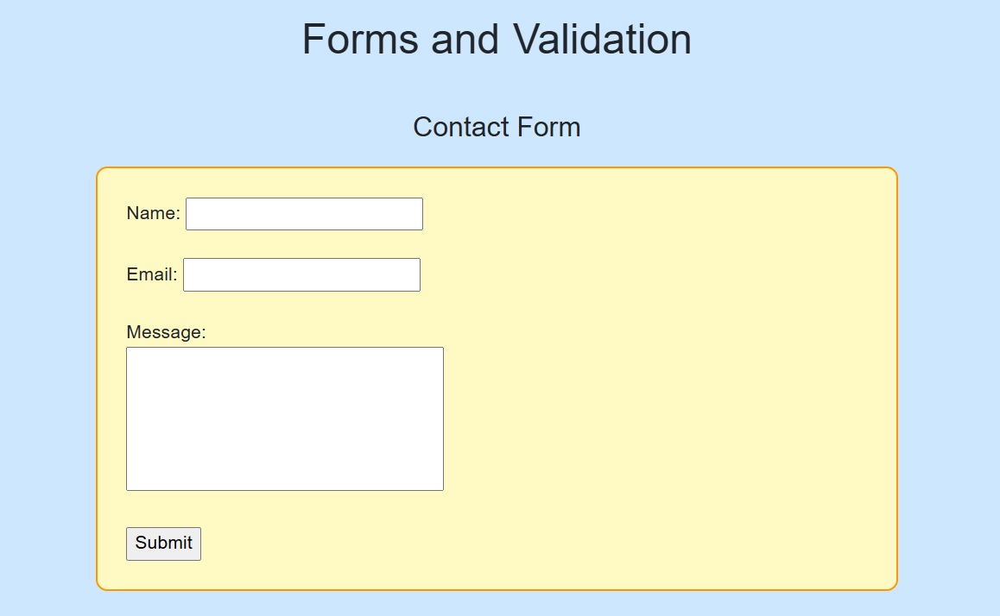
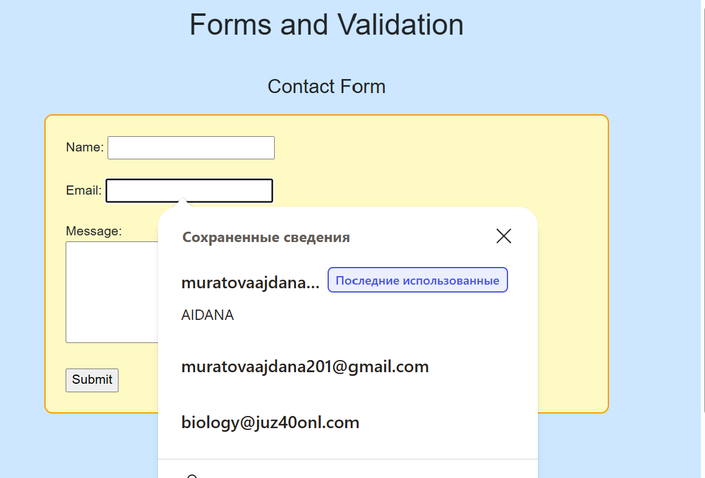
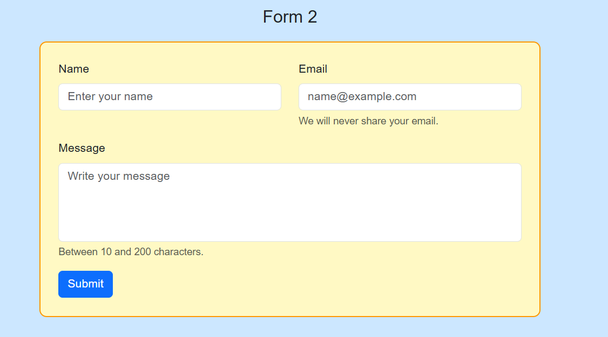
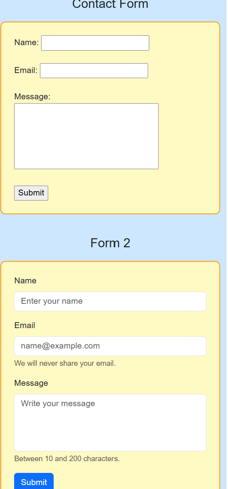
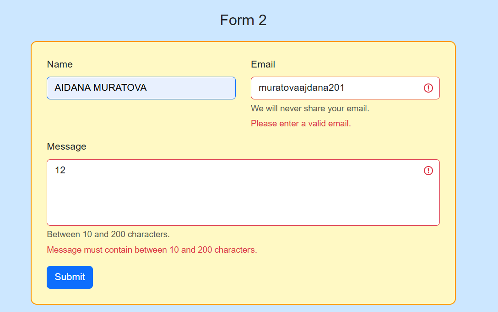
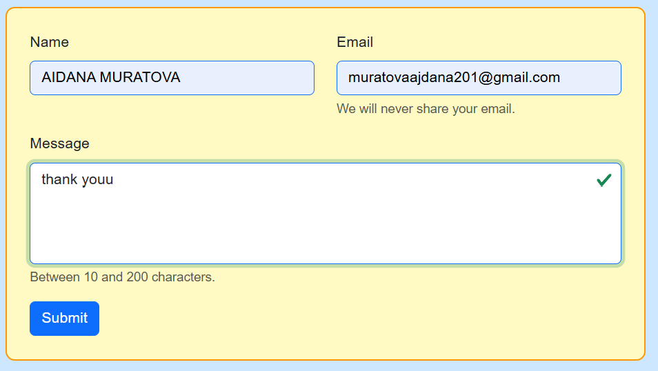
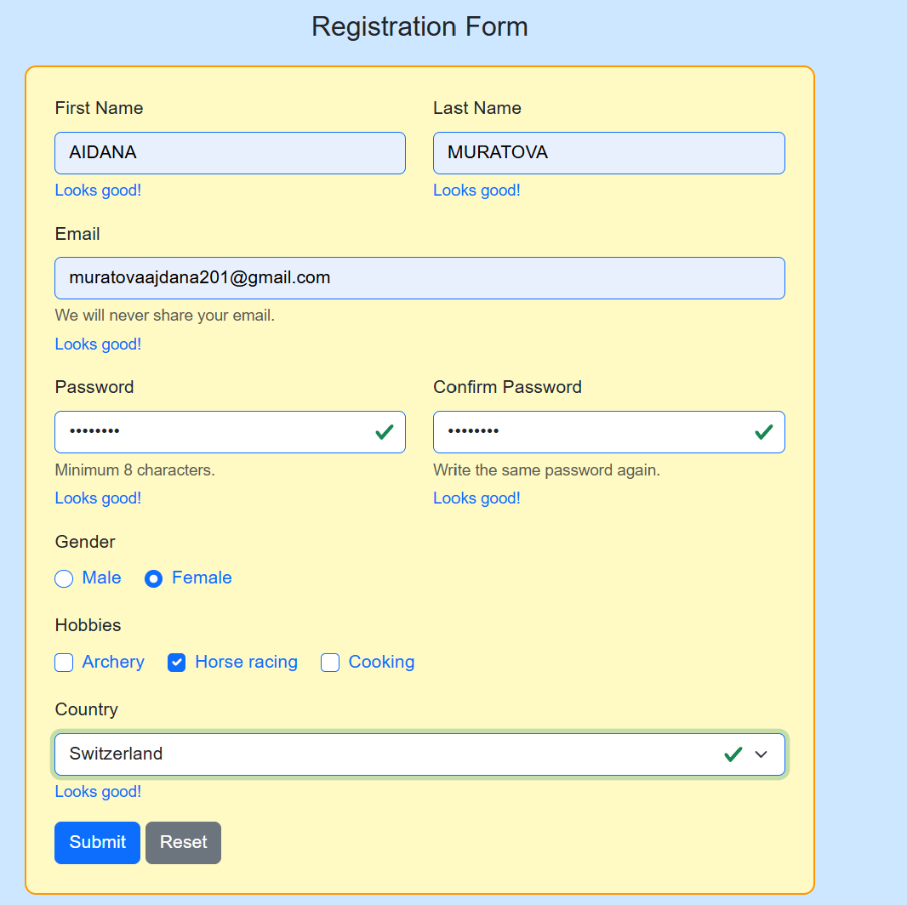
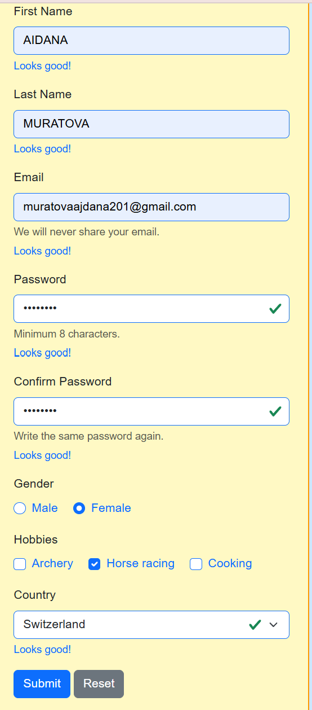

# Assignment 4. Forms and Validation

Name: Aidana Muratova

## Introduction

In this assignment, I created three forms on one HTML page called index.html. The first form is a simple contact form with HTML5 validation. The second form is a contact form styled with Bootstrap 5. The third form is a registration form with different input types and validation attributes.

I used HTML to create the structure of the forms and CSS to change their appearance. I connected Bootstrap 5 using a CDN link and added my own styles in style.css.

For the design, I chose a light blue background, light yellow form boxes, and orange borders. I also used rounded corners and padding to make the forms look clearer.

## Part 1. Basic HTML Forms

### Task 0. Simple Contact Form (Form 1)

I created a simple contact form with three fields: Name, Email, and Message. I also added a Submit button.

All the fields are inside the <form> tag. Each input has a label that describes what the user needs to enter.

I used type="text" for the name, type="email" for the email, and the <textarea> element for the message. The textarea is useful for longer text. I used rows="5" and cols="30" to set its initial size.

Every label is connected to its input using the for and id attributes. For example, for="name1" matches id="name1". When I click on the label, the corresponding input receives focus.

The Submit button has type="submit". It is used to submit the form.

### Task 1. Form with HTML5 Validation (Form 1)

For this task, I added HTML5 validation attributes to the same contact form.

I used required to make the fields mandatory. The type="email" attribute checks whether the entered value has a valid email format.

For the name field, I used minlength="2" and maxlength="30". This means that the name must contain between 2 and 30 characters.

For the message, I used minlength="10" and maxlength="200". This means that the message must contain between 10 and 200 characters.

I tested the form with empty fields and an incorrect email address. The browser showed validation messages and did not allow the form to be submitted when the entered data did not meet the requirements.

These validation messages are generated by the browser. Their appearance and language can depend on the browser settings.

## Part 2. Bootstrap Forms

### Task 2. Bootstrap Form Styling (Form 2)

In this task, I created another contact form and used Bootstrap classes to improve its appearance.

I used the following classes:

-form-label styles the labels.
-form-control styles the input fields and textarea.
-btn btn-primary styles the Submit button.
-mb-3 adds margin at the bottom of an element.
-form-text displays additional information under a field.

I also added placeholders. A placeholder is the text displayed inside an empty input to show the user what they can enter. For example, the email field has the placeholder name@example.com.

For the layout, I used the Bootstrap grid system. Bootstrap divides a row into 12 columns.

The classes col-12 col-md-6 make each field take the full width on small screens and half the width on medium and larger screens. The col-12 class uses all 12 columns, while col-md-6 uses 6 columns from the medium breakpoint, which starts at 768 pixels.

Because of this, the Name and Email fields appear side by side on larger screens and one under another on small screens.

I also used required, minlength, and maxlength to apply HTML5 validation to the fields.

### Task 3. Bootstrap Validation Styles (Form 2)

For this task, I used Bootstrap validation feedback classes in the contact form.

I added valid-feedback to display the message "Looks good!" and invalid-feedback to display an error message, such as "Email is required".

I also added form-text to explain the requirements for the message field. The message must contain between 10 and 200 characters.

The form uses Bootstrap classes such as form-control and form-label together with HTML5 validation attributes, including required, minlength, and maxlength.

The browser checks whether the entered data meets these requirements. Bootstrap provides the styling for validation feedback elements, while the HTML5 attributes define the validation rules.

In this version, I did not add JavaScript for custom validation. The form uses the HTML5 validation attributes and Bootstrap styling included in the HTML.

## Part 3. Advanced Form Project

### Task 4. Registration Form (Form 3)

For the final task, I created a registration form with different types of fields. It includes First Name, Last Name, Email, Password, Confirm Password, Gender, Hobbies, and Country.

I also added Submit and Reset buttons.

#### Name and Email Fields

The First Name and Last Name fields use type="text". Both fields are required and must contain between 2 and 30 characters.

The Email field uses type="email" and required. This means that the user must enter an email address in a valid format.

I used Bootstrap classes such as form-control, form-label, and form-text to style the fields and display additional information.

#### Password Fields

The Password and Confirm Password fields use type="password". This input type hides the characters while the user is typing.

Both fields have the required attribute and minlength="8", so each field must contain at least eight characters.

I also added helper text explaining the minimum password length and reminding the user to enter the password again in the confirmation field.

In this version, both password fields have their own HTML5 validation rules. However, the code does not compare the two values, so it does not check whether the passwords match.

#### Gender

I created two radio buttons: Male and Female.

Both inputs have type="radio" and the same name="gender". Because they belong to the same radio group, the user can select only one option.

I added the required attribute to make gender selection mandatory.

The form-check, form-check-inline, form-check-input, and form-check-label classes are used to style the radio buttons and their labels with Bootstrap.

#### Hobbies

For hobbies, I used checkboxes with the options Archery, Horse racing, and Cooking.

Checkboxes allow users to select multiple options independently. Unlike the gender radio buttons, the hobbies are optional because I did not add the required attribute.

I used Bootstrap classes to align the checkboxes and their labels.

#### Country

I created a dropdown menu using the <select> element. The available countries are Kazakhstan, Switzerland, and Turkey.

The first option is "Choose..." and has an empty value. The required attribute means that the user must select a country with a non-empty value before submitting the form.

I used the form-select class to apply Bootstrap styling to the dropdown menu.

#### Validation Feedback and Buttons

The registration form has the was-validated class. This class is used by Bootstrap to display validation styles.

I added valid-feedback and invalid-feedback elements to provide messages for fields such as First Name, Last Name, Email, Password, Confirm Password, and Country.

The Submit button has type="submit". It attempts to submit the form, and the browser checks the HTML5 validation rules.

The Reset button has type="reset". It resets the form fields to their initial values.

## Summary

First, I created a basic contact form with labels, inputs, a textarea, and a Submit button. Then I added HTML5 validation attributes to check the entered data.

After that, I created another contact form using Bootstrap 5 classes. I used the Bootstrap grid system to make the layout responsive, so the fields can appear in one or two columns depending on the screen size.

Next, I added validation feedback elements to the Bootstrap form. I learned how valid-feedback and invalid-feedback are used to display messages and how HTML5 validation attributes define the requirements for the fields.

Finally, I created a registration form with text fields, email, password inputs, radio buttons, checkboxes, and a dropdown menu. I used the required attribute and other validation attributes to define which fields must be completed and how many characters they can contain.

I also created a separate CSS file to customize the page background, form backgrounds, borders, spacing, and textarea resizing.

## Conclusion

In this assignment, I learned how to create HTML forms, validate user input, and style forms with Bootstrap and CSS.

The first important thing I learned was the structure of a form. The <form> tag contains the fields and buttons, while labels explain what users need to enter. I also understood why the for attribute of a label must match the id of its input.

Another important part was HTML5 validation. Attributes such as required, minlength, and maxlength define the requirements for user input. The type="email" attribute checks the format of an email address. I learned that the browser can perform these basic checks without JavaScript.

I also learned how Bootstrap makes forms easier to style. Classes such as form-control, form-label, form-select, and btn btn-primary provide ready-made styles. The mb-3 class adds spacing between fields, and form-text displays additional information.

The Bootstrap grid system was another important topic. I used col-12 col-md-6 to make the form responsive. On small screens, the fields take the full width, while on medium and larger screens, two fields can appear side by side.

In the registration form, I practiced using different input types. Radio buttons allow the user to select one option from a group, while checkboxes allow multiple independent selections. The <select> element provides a dropdown list of options.

I also learned that validation rules and validation messages are different things. HTML5 attributes define the rules, while Bootstrap classes provide the styling for feedback messages. The was-validated class is used to display Bootstrap validation styles.

The most important thing I understood is that a good form should be clear, easy to use, and able to check the data entered by the user. I also learned that basic HTML5 validation has limitations. For example, my current code checks the minimum password length but does not compare the Password and Confirm Password fields.

Overall, this assignment helped me practice HTML forms, HTML5 validation, Bootstrap classes, responsive layouts, and CSS styling. These skills will be useful in future web development assignments and projects.
